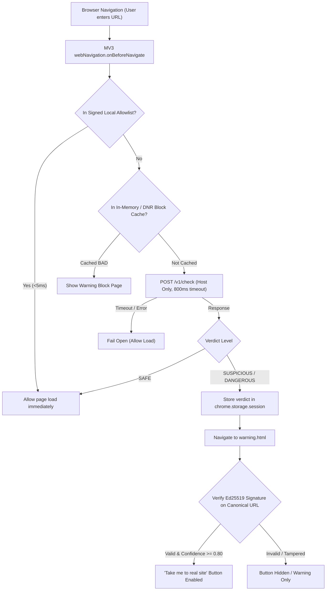

<div align="center">
  
  <h1>SPARTAN</h1>
  <p><strong>SiteGuard: Fake Website Detection and Safe Redirect to the Original Website</strong></p>
</div>

SiteGuard detects fake bank and government websites **before the page loads**, explains the risk in plain words, and offers a one-tap redirect to the **verified original website**.

- **Client:** Manifest V3 Browser Extension (Chrome, Edge, Brave, etc.)
- **Backend:** Stateless detection API (FastAPI, Python 3.12)
- **Source of Truth:** Signed Brand Registry with Ed25519 digital signatures

---
## PPT LINK:
https://drive.google.com/file/d/15D2szaVObtK_wQlTZJ02_ArQDB2mcg5D/view?usp=sharing

## Architecture Flow



---

## Core Rules

1. **Redirect targets come only from the signed registry**, never from the suspicious page, its URL, path, query, or referrer.
2. **Only the host name** is sent to the API. Never path, query, cookies, page content, or form data.
3. **Match registrable domains exactly** (Public Suffix List via `tldextract`), never by substring.
4. **Fail open on timeout (800 ms)**, but locally cached known-bad hosts stay blocked.
5. **Insert text with `textContent`**, never `innerHTML`.
6. The warning page address carries **no data in the URL**; the verdict is passed securely via `chrome.storage.session`.
7. Redirect is a **user tap** by default. No silent redirects.
8. Precision over recall at the block level. False-positive target under 0.1%.
9. Keep browsing history out of logs. Store aggregate counts and flagged hosts only.

---

## Repository Structure

```
spartan/
├── README.md
├── assets/                      # SPARTAN project logo & brand assets
├── .env.example                 # Configuration template (no secrets committed)
├── .gitignore                   # Excludes .env, *.pem, keys/
├── docker-compose.yml           # API + Redis + PostgreSQL
├── data/
│   └── badhosts.csv             # Local malicious host seed
├── backend/
│   ├── requirements.txt
│   ├── app/
│   │   ├── __init__.py
│   │   ├── main.py              # FastAPI app (POST /v1/check, /v1/report, etc.)
│   │   ├── config.py            # Pydantic-settings environment loader
│   │   ├── normalize.py         # Host normalisation, IDNA, punycode flag
│   │   ├── lookalike.py         # Typos, homoglyphs, combosquat, subdomain abuse engine
│   │   ├── risk.py              # 0-100 weighted risk score, overrides, levels
│   │   ├── registry.py          # Brand registry, domain pinning & Ed25519 signing
│   │   ├── feeds.py             # Threat feed manager & local badlist lookup
│   │   ├── domain_intel.py      # Domain intelligence signals
│   │   ├── reasons.py           # Multilingual reason catalog (en, hi, mr)
│   │   └── cache.py             # Redis cache with in-memory fallback
│   ├── scripts/
│   │   ├── gen_keys.py          # Generate Ed25519 signing keypair
│   │   ├── sign_registry.py     # Sign all brands.json entries
│   │   └── verify_brand.py      # Admin verification CLI for brands
│   └── tests/
│       ├── test_lookalike.py    # Typo/homoglyph/combosquat variant tests
│       ├── test_risk.py         # Scoring & override unit tests
│       ├── test_registry.py     # Signature & domain pinning tests
│       └── test_api.py          # Endpoints, privacy & benign corpus tests
├── extension/
│   ├── package.json
│   ├── tsconfig.json
│   ├── manifest.json            # Manifest V3 specification
│   ├── build.js                 # Esbuild compilation & asset pipeline
│   ├── src/
│   │   ├── background.ts        # webNavigation interception (<800ms)
│   │   ├── allowlist.ts         # Fast (<5ms) local signed allowlist
│   │   ├── verify.ts            # Web Crypto native Ed25519 signature verification
│   │   ├── warning.html / .ts   # High-contrast accessible block page
│   │   ├── popup.html / .ts     # Toolbar popup with risk bar
│   │   └── i18n/ (en, hi, mr)   # English, Hindi, Marathi strings
│   └── dist/                    # Compiled extension bundle ready to load
└── registry/
    ├── brands.json              # Signed official brand registry (625 brands)
    ├── brands_seed.json         # Raw expanded seed data
    ├── brands_seed.psv          # Raw PSV source data
    └── schema.json              # JSON Schema for brand entries
```

---

## Local Setup & Quickstart

### 1. Prerequisites
- Python 3.12+
- Node.js 18+ & npm
- (Optional) Docker for Redis & PostgreSQL

### 2. Backend Setup

```bash
# Navigate to backend and create virtual environment
cd backend
python3 -m venv .venv
source .venv/bin/activate  # On Windows: .venv\Scripts\activate

# Install dependencies
pip install -r requirements.txt

# Generate Ed25519 signing keypair (automatically configures .env)
python scripts/gen_keys.py

# Validate and sign the brand registry (625 brands)
python scripts/sign_registry.py

# Run the API server
PYTHONPATH=. uvicorn app.main:app --reload --port 8000
```

Interactive API documentation will be available at: `http://127.0.0.1:8000/docs`

### 3. Test with cURL

```bash
# Check a dangerous phishing lookalike
curl -X POST http://127.0.0.1:8000/v1/check \
  -H "Content-Type: application/json" \
  -d '{"host": "examplebank-secure-login.xyz"}'

# Expected response:
# {
#   "host": "examplebank-secure-login.xyz",
#   "level": "DANGEROUS",
#   "score": 91,
#   "reasons": ["The name imitates Example Bank", "Combines Example Bank with extra trust words", ...],
#   "brand": {
#     "name": "Example Bank",
#     "confidence": 0.85,
#     "official_url": "https://www.examplebank.bank.in/",
#     "signature": "..."
#   },
#   "ttl": 3600,
#   "analysis": "completed"
# }
```

### 4. Running Backend Tests

```bash
cd backend
PYTHONPATH=.:scripts pytest -v
```

### 5. Extension Setup (Chrome / Edge / Brave)

```bash
# Navigate to extension directory
cd ../extension

# Install build dependencies
npm install

# Build the extension into dist/
npm run build
```

**Load into Browser:**
1. Open your browser and navigate to `chrome://extensions` (or `edge://extensions`).
2. Enable **Developer mode** (toggle in upper right).
3. Click **Load unpacked** and select the `siteguard/extension/dist` directory.
4. Pin SiteGuard to your toolbar.
5. In a tab, navigate to `http://examplebank-secure-login.xyz`. The pre-navigation check intercepts the page, displays the red block page, and presents the green button: **"Take me to the real Example Bank website"** (`www.examplebank.bank.in`).

### 6. Admin CLI: Brand Verification

```bash
# Verify a brand after manual domain audit
python backend/scripts/verify_brand.py state-bank-of-india "auditor-name"
```

---

## Phase 1 & 2 Verification Status

- [x] **29 pytest tests passing in ~6s**, including generated typo/homoglyph/combosquat variants, RDAP age, Tranco, DNS health.
- [x] Benign corpus (top popular global domains + genuine subdomains across registered brands) produces **0** DANGEROUS verdicts and a false-positive rate under 0.1%.
- [x] `examplebank.com.attacker.net` is NOT treated as official; `examplebank.bank.in.verify-user.xyz` is flagged as subdomain abuse.
- [x] Tampering with `official_url` or signature makes the button disappear.
- [x] Extension loads unpacked in Chrome/Edge and displays the block page with working redirect for `examplebank-secure-login.xyz`.
- [x] API unreachable: fails open, while previously cached bad hosts stay blocked via DeclarativeNetRequest.
- [x] No path/query ever appears in an API request or is processed by the API.
- [x] Phase 2 Domain Intelligence active: RDAP creation date parsing (<30 days flag), Tranco Top 1M popularity check, and DNS health resolver.

---

## Git & Pull Request

Branch: [`feat/phase-1-mvp`](https://github.com/LavishFargoseAIE/SPARTAN-/tree/feat/phase-1-mvp)  
Pull Request: [Create PR on GitHub](https://github.com/LavishFargoseAIE/SPARTAN-/pull/new/feat/phase-1-mvp)
